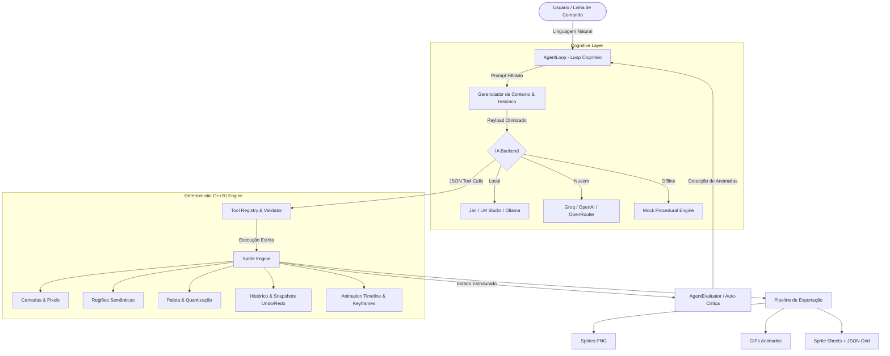

<div align="center">

# ⚔️ PixelForge AI

**Motor Autônomo de Pixel Art e Animação Controlado por IA em C++20 Moderno**

*A IA planeja. O Sprite Engine desenha deterministicamente. A autoavaliação corrige.*

[](https://en.cppreference.com/w/cpp/20)
[](https://cmake.org/)
[](#-arquitetura-do-sistema)
[](LICENSE)
[](#-otimização-extrema-de-contexto--tokens)
[](#-provedores-e-modelos-suportados)

</div>

---

## 📖 Sumário

- [Visão Geral e Filosofia](#-visão-geral-e-filosofia)
- [Por que Tool Calling em vez de Difusão?](#-por-que-tool-calling-em-vez-de-difusão)
- [⚡ Otimização Extrema de Contexto & Tokens](#-otimização-extrema-de-contexto--tokens)
- [Arquitetura do Sistema](#-arquitetura-do-sistema)
- [Percepção Espacial sem Visão Computacional](#-percepção-espacial-sem-visão-computacional)
- [Recursos Principais](#-recursos-principais)
- [Compilação e Instalação](#-compilação-e-instalação)
- [Configuração Zero-Recompilação (`pixelforge.json`)](#-configuração-zero-recompilação-pixelforgejson)
- [Provedores e Modelos Suportados](#-provedores-e-modelos-suportados)
- [Guia de Uso (CLI & REPL)](#-guia-de-uso-cli--repl)
- [Catálogo de Ferramentas Estruturadas (43 Tools)](#-catálogo-de-ferramentas-estruturadas-43-tools)
- [Estrutura do Projeto](#-estrutura-do-projeto)
- [Contribuição](#-contribuição)
- [Licença](#-licença)

---

## 🌟 Visão Geral e Filosofia

O **PixelForge AI** é um ecossistema completo e determinístico de criação e animação de pixel art profissional, escrito em **C++20 moderno**. 

Diferente de geradores de imagem convencionais, o PixelForge AI opera sob um princípio estrito de engenharia:

> **«Você descreve sua intenção em linguagem natural. A IA atua como arquiteto e diretor técnico, emitindo chamadas a ferramentas estruturadas (*Tool Calling*). O motor nativo executa as operações rasterizadas no nível do pixel, inspeciona o estado resultante e aplica correções geométricas em tempo real.»**

### Princípios de Engenharia
1. **Determinismo Absoluto:** Cada pixel desenhado, linha traçada ou região movida respeita coordenadas inteiras exatas e controle estrito de paleta, sem borrões ou gradientes acidentais.
2. **Independência de GPU/VRAM:** O motor roda inteiramente no processador (CPU) em alta velocidade, sendo compatível com modelos de linguagem locais compactos (1B a 8B parâmetros) ou provedores remotos ultrarrápidos.
3. **Loop Cognitivo com Autoavaliação:** O agente não apenas executa os comandos, mas audita estruturalmente sua própria obra (detecção de ruído, pixels órfãos, violações de borda e discrepâncias entre frames).

---

## 🥊 Por que Tool Calling em vez de Difusão?

Modelos de difusão tradicionais (Stable Diffusion, Midjourney, DALL-E) falham sistematicamente nas regras fundamentais de pixel art retrô autêntico:

| Critério | Modelos de Difusão (SD / DALL-E) | **PixelForge AI (Tool Calling + C++20)** |
|---|---|---|
| **Grid Alignment** | ❌ Interpolações, anti-aliasing e meio-tons borrados | ✔️ **Grade inteira estrita (pixels 100% sólidos ou transparentes)** |
| **Paleta Controlada** | ❌ Gera centenas de cores espúrias em gradientes | ✔️ **Paletas indexadas restritas (8, 16 ou 32 cores)** |
| **Camadas & Regiões** | ❌ Raster achatado sem noção semântica de membros | ✔️ **Regiões semânticas nomeadas (`head`, `weapon`, `body`)** |
| **Animação Multi-Frame** | ❌ Inconsistência temporal e deformações grotescas | ✔️ **Keyframing determinístico, interpolação e FrameDiffer** |
| **Iterabilidade** | ❌ Pedir para "mover a espada 2px" regenera a imagem toda | ✔️ **Comando cirúrgico: `move_region("weapon", 2, 0)`** |
| **Consumo de Hardware** | ❌ Requer GPUs dedicadas com 8GB a 24GB de VRAM | ✔️ **Zero VRAM necessária (C++20 CPU ultra-otimizado)** |

---

## ⚡ Otimização Extrema de Contexto & Tokens

Projetado especificamente para rodar com **LLMs locais em CPUs modestas** (Jan, LM Studio, Ollama, llama.cpp), o PixelForge AI implementa um motor avançado de economia de contexto:

```
[ Usuário ] ──► Prompt ──► [ Dynamic Tool Filter ] ──► Schema Enxuto (2.8 KB vs 22 KB)
                                                               │
[ Sprite State ] ◄── [ Sliding Window History ] ◄── [ LLM Local / Remoto ]
```

### 1. Filtragem Semântica Dinâmica de Ferramentas (`Smart Toolset Selection`)
- Em vez de saturar o modelo com a definição completa de todas as 43 ferramentas (~22 KB / ~3.400 tokens), o motor analisa o prompt e o estado atual para fornecer apenas o conjunto relevante (10 a 14 ferramentas, ~2.8 KB / ~450 tokens).
- **Economia de até 85% do overhead de prompt** em cada requisição.
- Reduz o tempo de avaliação inicial de prompt (CPU prompt eval) de **~350s para menos de 25s**.

### 2. Janela Deslizante com Compactação de Turnos Anteriores (`History Compactor`)
- Em sessões interativas de múltiplos turnos (REPL), as chamadas granulares de ferramentas antigas tornam-se redundantes após a conclusão do passo.
- O histórico é compactado preservando a intenção do usuário e o resumo de conclusão do assistente, removendo dezenas de mensagens intermediárias de ferramentas sem quebrar a conformidade com a API OpenAI.

### 3. Telemetria Concisa de Validação (`Compact Tool Output`)
- Quando uma ferramenta é executada com sucesso e sem avisos estruturais, a resposta é formatada em uma única linha compacta:  
  `[SUCCESS] Drew rectangle at (10, 10 12x12) (valid, bbox=[10,10 12x12], colors=3)`
- O relatório verboso multilinhas só é ativado se houver ruído, pixels fora dos limites ou alertas que exijam correção da IA.

---

## 🏛️ Arquitetura do Sistema



---

## 👁️ Percepção Espacial sem Visão Computacional

Como o PixelForge AI opera com modelos sem capacidade visual (LLMs puramente textuais)?

O Sprite Engine gera uma **matriz ASCII compacta com indexação cartesiana** e sumário dimensional estruturado:

```text
=== SPRITE STATE ===
Resolution: 16x16
Colors: 3 | Transparent: yes
BoundingBox: x=4..11 y=4..11 (size 8x8)

Regions (2):
  body: (4,4)-(11,11) [size 8x8]
  eyes: (5,6)-(10,7) [size 6x2]

ASCII Matrix Preview:
    0    5    10   15
    0123456789012345
   +----------------+
04 |    .######.    |
05 |   .########.   |
06 |   .#@@##@@#.   |
07 |   .########.   |
08 |   .########.   |
09 |    .######.    |
   +----------------+
Legend:
  . = Transparent
  # = #42B842 (Corpo - Verde)
  @ = #FFFFFF (Olhos - Branco)
```

O modelo compreende proporções, bounding boxes e coordenadas diretamente no espaço de tokens de texto, garantindo precisão geométrica cirúrgica.

---

## ✨ Recursos Principais

- 🧠 **Agente Autônomo com Autoavaliação:** Validação contínua contra ruídos isolados, desconexões e consistência de bounds.
- 🛠️ **43 Ferramentas Estruturadas:** Primitivas 2D, flood fill, polígonos, contornos inteligentes, sombras projetadas e interpolação.
- 🏷️ **Regiões Semânticas:** Rótulos nomeados para partes do sprite (`head`, `torso`, `arm_l`, `sword`), viabilizando animações sem retrabalho manual.
- 🎨 **Paletas Retrô Consagradas:** Presets integrados para Pico-8, GameBoy, DawnBringer 16/32, Endesga 32 e quantização automática por distância euclidiana.
- 🎞️ **Animation Engine Multi-Frame:** Linha do tempo com suporte a keyframes, medição de consistência via `FrameDiffer` e controle de frame rate em milissegundos.
- 📦 **Exportação Profissional:** Exporta PNGs nítidos (RGBA), sprite sheets organizados em grade com metadados JSON e GIFs animados contínuos.
- ⚡ **Zero Dependências Pesadas:** Bibliotecas autocontidas single-header (`nlohmann/json`, `stb_image`, `gifenc`).

---

## 💻 Compilação e Instalação

### Pré-requisitos
- Compilador compatível com **C++20** (GCC 11+, Clang 13+, MSVC 2022)
- **CMake** 3.20+ ou **Make**

### Compilação Rápida (Recomendada)
```bash
# Clonar o repositório
git clone https://github.com/seu-usuario/pixelforgeAI.git
cd pixelforgeAI

# Compilar via Make
make -j$(nproc)
```

### Compilação via CMake
```bash
cmake -B build -DCMAKE_BUILD_TYPE=Release
cmake --build build -j$(nproc)
```

Binários gerados em `build/`:
- `build/pixel-forge` — Executável principal (CLI e REPL interativo)
- `build/pixel-forge-example` — Exemplo de integração do engine como biblioteca C++

---

## ⚙️ Configuração Zero-Recompilação (`pixelforge.json`)

Você não precisa recompilar o código para trocar o modelo ou provedor de IA. Basta editar o arquivo central [`pixelforge.json`](pixelforge.json):

```jsonc
{
  // Selecione o perfil ativo: "jan", "lmstudio", "ollama", "groq", "openrouter", "openai", "mock"
  "active_profile": "jan",

  "profiles": {
    "jan": {
      "type": "http",
      "api_url": "http://localhost:1337/v1",
      "model": "auto",           // Detecta automaticamente o modelo carregado no Jan!
      "temperature": 0.2,
      "timeout_seconds": 180
    },
    "lmstudio": {
      "type": "http",
      "api_url": "http://localhost:1234/v1",
      "model": "auto",           // Detecta automaticamente o modelo no LM Studio!
      "temperature": 0.2,
      "timeout_seconds": 300
    },
    "ollama": {
      "type": "http",
      "api_url": "http://localhost:11434/v1",
      "model": "gemma-4-e4b",
      "temperature": 0.2,
      "timeout_seconds": 90
    },
    "groq": {
      "type": "http",
      "api_url": "https://api.groq.com/openai/v1",
      "api_key": "COLOQUE_SUA_CHAVE_AQUI",
      "model": "llama-3.3-70b-versatile",
      "temperature": 0.2,
      "timeout_seconds": 45
    },
    "mock": {
      "type": "mock",            // Funciona offline sem qualquer IA instalada!
      "model": "procedural-mock"
    }
  },

  "agent": {
    "max_iterations": 15,
    "context_mode": "smart",     // "smart" (economiza 85% de tokens), "minimal" ou "full"
    "max_history_turns": 3,
    "compact_tool_output": true
  }
}
```

### Variáveis de Ambiente (Overrides Opcionais)
```bash
export PIXELFORGE_BACKEND=http
export PIXELFORGE_API_URL=http://localhost:11434/v1
export PIXELFORGE_MODEL=llama3.2
export PIXELFORGE_CONTEXT_MODE=smart
```

---

## 🤖 Provedores e Modelos Suportados

| Provedor | Tipo | Detecção Automática de Modelo | Recomendação de Modelo |
|---|---|:---:|---|
| **Jan.ai** | Local (GUI) | ✔️ `auto` | Qwen 2.5 Coder 7B / Llama 3.2 3B |
| **LM Studio** | Local (GUI) | ✔️ `auto` | Mistral Nemo 12B / Gemma 2 9B |
| **Ollama** | Local (CLI) | Manual / API | `gemma:4b`, `llama3.2`, `qwen2.5-coder` |
| **llama.cpp** | Local (Server) | ✔️ `default` | Qualquer arquivo `.gguf` quantizado |
| **Groq** | Nuvem Ultrarrápida | Manual | `llama-3.3-70b-versatile` |
| **OpenRouter / OpenAI** | Nuvem | Manual | `gpt-4o-mini`, `google/gemma-2-9b-it` |
| **Mock Engine** | Embutido C++ | N/A | Procedural nativo (offline, CI/CD) |

---

## 🎮 Guia de Uso (CLI & REPL)

### 1. Modo Interativo (REPL)
Inicie o aplicativo sem parâmetros para entrar no terminal interativo com pré-visualização ASCII:

```bash
./build/pixel-forge
```

```text
pixel-forge> Crie um pinguim com uma panela na cabeça como chapéu 32x64
pixel-forge> Mude a cor do cachecol para azul safira
pixel-forge> Faça uma animação dele piscando os olhos em 4 frames
pixel-forge> export pinguim_animado.gif
pixel-forge> profile lmstudio
pixel-forge> info
pixel-forge> undo
pixel-forge> exit
```

### 2. Linha de Comando Direta
```bash
# Criação direta de canvas
./build/pixel-forge create 32 32 heroi

# Geração via prompt
./build/pixel-forge prompt "Crie um cavaleiro medieval 32x32 com espada e escudo"

# Geração de animação
./build/pixel-forge animate "Crie uma animação de pulo com 6 frames"

# Abrir e inspecionar sprite existente
./build/pixel-forge open assets/NPC_Pinguim.png

# Exportação para múltiplos formatos
./build/pixel-forge export assets/heroi.png
./build/pixel-forge export assets/heroi_sheet.png
./build/pixel-forge export assets/heroi_pulo.gif
```

---

## 🛠️ Catálogo de Ferramentas Estruturadas (43 Tools)

### 🖌️ Ferramentas Primitivas e Desenho 2D
| Nome | Parâmetros | Descrição |
|---|---|---|
| `create_sprite` | `width`, `height`, `background_color` | Inicializa ou redimensiona a grade de pixels. |
| `get_sprite_info` | — | Retorna resolução, bounding box, paleta e contagem. |
| `set_pixel` | `x`, `y`, `color` | Escreve um pixel sólido com coordenadas inteiras. |
| `clear_pixel` | `x`, `y` | Apaga o pixel tornando-o transparente (a=0). |
| `draw_line` | `x0`, `y0`, `x1`, `y1`, `color` | Traçado linear via algoritmo determinístico de Bresenham. |
| `draw_rectangle`| `x`, `y`, `width`, `height`, `color`, `fill` | Retângulos vazados ou preenchidos. |
| `draw_polygon` | `points`, `color`, `fill` | Rasterização scanline de polígonos convexos/côncavos. |
| `fill_region` | `x`, `y`, `color`, `match_alpha` | Flood Fill 4-conectado (balde de tinta). |
| `replace_color` | `old_color`, `new_color`, `region` | Substituição atômica global ou restrita a uma região. |
| `set_palette` | `name` ou `colors` | Aplica paletas retro consagradas (Pico-8, DB16, GB). |
| `add_color` / `remove_color` | `color` | Gerencia slots específicos da paleta ativa. |
| `flip_horizontal` / `flip_vertical` | `region` | Espelhamento de pixels nos eixos X ou Y. |
| `undo` / `redo` | — | Navegação no histórico de snapshots do engine. |

### 🏷️ Ferramentas Semânticas de Alto Nível
| Nome | Parâmetros | Descrição |
|---|---|---|
| `create_outline` | `color`, `diagonal`, `region` | Gera contorno limpo (4-way ou 8-way) ao redor da silhueta. |
| `remove_outline` | `region` | Remove borda perimetral mantendo a área interna intacta. |
| `add_shadow` | `dx`, `dy`, `color`, `region` | Projeta sombra direcional nas células adjacentes de fundo. |
| `add_highlight` | `dx`, `dy`, `color`, `region` | Insere brilho e iluminação nas bordas opostas da figura. |
| `quantize_palette`| `max_colors` | Agrupa e reduz cores excedentes para o limite informado. |
| `symmetrize_region` | `region`, `axis` | Espelha metades para criar simetria perfeita em faces e escudos. |
| `clean_pixel_noise`| `threshold` | Elimina pixels órfãos que violam as regras estéticas de pixel art. |
| `identify_color_clusters` | — | Detecta blobs contíguos e cadastra regiões automaticamente. |
| `create_region` / `rename_region` / `delete_region` | `name`, `bounds` | Registra e gerencia regiões semânticas por nome. |
| `move_region` / `copy_region` / `erase_region` | `name`, `dx`, `dy` | Desloca, duplica ou limpa blocos de pixels semânticos. |

### 🎞️ Ferramentas de Animação e Linha do Tempo
| Nome | Parâmetros | Descrição |
|---|---|---|
| `create_animation` | `name`, `fps` | Inicia uma linha do tempo vinculando o sprite atual como Frame 0. |
| `add_frame` | `duration_ms` | Adiciona um novo frame em branco à linha do tempo. |
| `duplicate_frame` | `source_frame_idx` | Clona keyframe anterior como base para novas poses. |
| `insert_frame` / `delete_frame` | `frame_idx` | Controle de inserção e remoção sequencial de frames. |
| `set_frame_duration` | `frame_idx`, `duration_ms` | Ajusta o tempo de permanência de um quadro específico. |
| `get_frame` / `update_frame` | `frame_idx` | Carrega e comita o quadro ativo no espaço de trabalho. |
| `compare_frames` | `frame_a`, `frame_b` | Diff estruturado de pixels modificados entre keyframes. |
| `copy_region_between_frames` | `region`, `src`, `dst` | Replica membros ou acessórios entre quadros consecutivos. |
| `interpolate_region` | `region`, `f0`, `f1`, `steps` | Interpolação linear da posição de uma região entre poses. |

---

## 📁 Estrutura do Projeto

```
pixelforgeAI/
├── CMakeLists.txt              # Configuração de compilação CMake (C++20)
├── Makefile                    # Automação de compilação, testes e limpeza
├── README.md                   # Documentação arquitetural e manual
├── LICENSE                     # Licença de código aberto MIT
├── pixelforge.json             # Configuração central de modelos e limites
├── third_party/                # Dependências autocontidas (zero overhead)
│   ├── nlohmann/json.hpp       # Parser JSON para Tool Calling e metadados
│   ├── stb/                    # stb_image e stb_image_write para PNG
│   └── gifenc/                 # Codificador C de GIFs animados
├── include/
│   ├── core/                   # Config, Types, Error, Logger, ValidationReport
│   ├── sprite/                 # Sprite, Layer, Region, Palette, History, SpriteState
│   ├── tools/                  # ITool, ToolRegistry, PrimitiveTools, SemanticTools
│   ├── animation/              # Frame, Animation, FrameDiffer, SpriteSheet, AnimationTools
│   ├── io/                     # PngIO, GifIO, SpriteSheetIO
│   ├── agent/                  # IAgentBackend, AgentLoop, MockBackend, HttpBackend
│   └── cli/                    # CliApp, terminal colors e comandos REPL
├── src/                        # Implementações dos componentes (.cpp)
├── scripts/                    # Utilitários auxiliares de geração e testes
└── assets/                     # Sprites, folhas e animações geradas
```

---

## 🤝 Contribuição

Contribuições são muito bem-vindas! Para colaborar:

1. Faça um Fork do projeto (`git checkout -b feature/NovaFuncionalidade`)
2. Desenvolva sua funcionalidade e certifique-se de compilar com `make`
3. Siga as convenções de [Conventional Commits](https://www.conventionalcommits.org/):
   - `feat: adiciona ferramenta de rotação por algoritmo de shearing`
   - `fix: corrige cálculo de bounding box em regiões vazias`
   - `perf: otimiza serialização de esquemas de ferramentas`
4. Abra um Pull Request detalhado.

---

## 📝 Licença

Distribuído sob a licença **MIT**. Consulte [`LICENSE`](LICENSE) para mais detalhes.

---

<div align="center">
  <sub>Criado com paixão por jogos retrô, engenharia de software determinística e inteligência artificial de alta eficiência.</sub>
</div>
